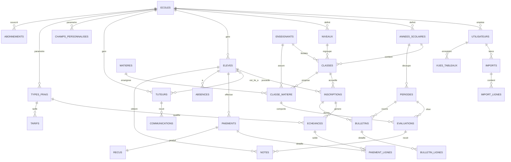

# SPEC_ecolio_2026-11-18_v2.md : Cahier des charges fonctionnel et technique

- Date : 2026-11-18 | Version : 0.2 (remplace `SPEC_sekoly-mora_2026-11-18.md`, seul le nom change) | Auteur : Claude, sur la demande du porteur
- Produit : application web installable (PWA) de gestion d'école privée, vendue par abonnement
- Nom : **Écolio** (retenu par le porteur le 2026-11-18, voir section 0.2)
- Stack imposée par le porteur : Laravel (API), Vue.js 3, Tailwind CSS, shadcn-vue, PWA

> **Statut des informations.** Le besoin vient d'un seul appel à une seule directrice, rapporté par le porteur (pas verbatim). Tout ce qui n'a pas été dit par elle est une **hypothèse de conception**, marquée `[Hypothèse]` ou listée en section 13. Rien dans ce document n'est un chiffre de marché. Les estimations de durée sont des ordres de grandeur du porteur et de l'agent, non mesurés.

---

## 0. Cadrage

### 0.1 Ce que la directrice a demandé (source : appel du 2026-11-17)
1. Un outil classé par **numéro de matricule**.
2. Des **cases à cocher** pour : écolage payé, absence, départ de l'école.
3. Une **facture ou un reçu généré** automatiquement.
4. Aujourd'hui : Excel pour les inscriptions, l'écolage et les bulletins ; réunions de parents en présentiel.

### 0.2 Nom de l'application
**Écolio**, retenu par le porteur le 2026-11-18. Nom français, court, facile à dire au téléphone et à écrire sur Facebook.

- Écriture : « Écolio » dans les textes, `ecolio` pour le dépôt, le domaine et les identifiants techniques.
- Alternatives écartées : Scolia, Classio, Cahier+, SchoolDesk, puis les noms malagasy (Sekoly Mora, Tahiry Sekoly, Fianara).
- Point d'attention : « Écolio » peut évoquer « écolo » (écologie). À tester auprès de la directrice et d'un ou deux autres directeurs.
- [Disponibilité du nom de domaine, du nom sur le Play Store, sur Facebook et dans les registres de marques : **non vérifiée**. À contrôler avant toute impression ou publication.]

### 0.3 Objectifs
- O1. Remplacer le cahier et l'Excel de la secrétaire par un registre unique par matricule.
- O2. Encaisser et suivre l'écolage avec reçu numéroté en un geste.
- O3. Importer les fichiers Excel existants sans ressaisie.
- O4. Fonctionner sur téléphone (PWA) et supporter une connexion et une électricité instables.
- O5. Être multi-écoles dès le départ (une école = un client abonné), avec données strictement séparées.

### 0.4 Hors périmètre de la version 1 `[Hypothèse]`
Comptabilité complète, paie des enseignants, cantine et transport (sauf comme types de frais simples), emploi du temps, bibliothèque, intégration directe de l'API mobile money, application native Android/iOS dans les stores, signature électronique.

---

## 1. Acteurs et rôles

| Rôle | Qui | Accès principal |
|------|-----|-----------------|
| `super_admin` | Le porteur (back-office plateforme) | Écoles, abonnements, support. Jamais mélangé avec l'app école |
| `directeur` | Directrice, fondateur | Tout dans son école, y compris tarifs, annulations, utilisateurs, exports |
| `secretaire` | Secrétaire ou économe | Élèves, inscriptions, encaissements, absences, imports. Pas les tarifs ni les annulations de reçus (voir RG-P7) |
| `enseignant` | Enseignant | Ses classes : absences, notes. Lecture seule sur la liste des élèves de ses classes |
| `parent` | Tuteur (phase 5) | Lecture : solde, reçus, bulletins de son enfant |

Matrice détaillée (C = créer, L = lire, M = modifier, S = supprimer ou annuler, - = rien) :

| Ressource | directeur | secretaire | enseignant | parent |
|-----------|-----------|------------|------------|--------|
| Élèves, tuteurs | CLMS | CLM | L (ses classes) | L (son enfant) |
| Inscriptions, classes | CLMS | CLM | L | - |
| Champs personnalisés et vues | CLMS | L, vues perso | L | - |
| Tarifs, types de frais | CLMS | L | - | - |
| Paiements, reçus | CLMS | CL, annulation sur demande validée | - | L (ses reçus) |
| Absences | CLMS | CLM | CLM (ses classes) | L |
| Notes, évaluations | CLMS | L | CLM (ses matières) | - |
| Bulletins | CLMS | L, imprimer | L | L |
| Imports | CLMS | CLM | - | - |
| Utilisateurs, paramètres | CLMS | - | - | - |
| Journal d'audit | L | - | - | - |

---

## 2. Spécifications fonctionnelles

Convention : **US** = récit utilisateur, **RG** = règle de gestion, **CA** = critère d'acceptation.

### M1. Authentification et compte
- US1.1 Se connecter par e-mail ou numéro de téléphone + mot de passe.
- US1.2 Réinitialiser son mot de passe (lien par e-mail ; par code SMS en phase 5).
- US1.3 Le directeur crée les comptes de son équipe et leur attribue un rôle.
- RG-A1 Un utilisateur appartient à une seule école (v1).
- RG-A2 Mot de passe : 8 caractères minimum. Verrouillage temporaire après 5 échecs.
- RG-A3 Session PWA : jeton longue durée (30 jours) pour ne pas redemander le mot de passe à chaque coupure.
- CA : un utilisateur de l'école A ne peut jamais lire ni écrire une donnée de l'école B (test automatique obligatoire).

### M2. Paramétrage de l'école
- US2.1 Renseigner nom, logo, adresse, téléphone, mention légale et signature du reçu.
- US2.2 Créer l'année scolaire (dates) et marquer l'année courante.
- US2.3 Définir les niveaux (ex. maternelle, primaire, collège, lycée) et les classes de l'année.
- US2.4 Définir le **format du matricule** (préfixe, année, longueur, compteur) ou conserver celui de l'école.
- RG-S1 Une seule année courante par école.
- RG-S2 Changement d'année : les classes, tarifs et échéances sont propres à l'année ; les élèves sont conservés.

### M3. Registre des élèves (tableau dynamique)
- US3.1 Voir la liste des élèves de l'année courante dans un tableau : recherche, filtres, tri, pagination, sélection multiple.
- US3.2 Créer et modifier une fiche élève (noyau + champs personnalisés + tuteurs).
- US3.3 **Ajouter, renommer, réordonner, masquer ou supprimer des colonnes** (voir section 3).
- US3.4 Enregistrer des **vues** (ex. « 6e A, impayés septembre ») personnelles ou partagées.
- US3.5 Exporter la vue courante en Excel ou CSV.
- RG-E1 Le **matricule est unique par école** et immuable une fois créé (correction réservée au directeur, journalisée).
- RG-E2 Statuts : `actif`, `sorti` (départ), `transfere`, `abandon`, `diplome`. Un élève sorti n'est pas supprimé : il reste consultable et ses reçus aussi.
- RG-E3 Suppression physique interdite s'il existe un paiement ou une note. Dans ce cas : archivage.
- RG-E4 Détection de doublons à la création : même nom + prénoms + date de naissance → avertissement bloquant à confirmer.

### M4. Cases à cocher : écolage, absences, départs (le cœur du besoin)
Un écran unique, **Registre du jour / du mois**, qui ressemble à son Excel.

- US4.1 **Écolage.** Choisir une classe et un mois : une ligne par élève, une case « payé » par mois. Cocher ouvre un panneau minimal (montant pré-rempli = montant dû, date du jour, mode de paiement). Valider crée le paiement et le reçu.
- US4.2 **Absences.** Choisir une classe et une date : une case « absent » par élève (et période matin / après-midi si activée). Un bouton « tous présents » pré-coche, on décoche les absents.
- US4.3 **Départ.** Action « Marquer comme sorti » sur la ligne : date, motif (déménagement, impayé, transfert, autre), commentaire.
- US4.4 Recherche instantanée par matricule ou nom pour retrouver une ligne.
- RG-P1 Cocher un mois **sans paiement saisi** n'existe pas : cocher = encaisser. Pas de case « payé » sans reçu.
- RG-P2 Paiement partiel autorisé : l'échéance passe à `partiel`, la case est à moitié cochée.
- RG-P3 Paiement groupé autorisé (le parent paie 3 mois d'un coup, ou plusieurs enfants d'une même famille) : un seul reçu, plusieurs lignes.
- RG-P4 **Décocher n'efface rien** : cela déclenche une annulation (motif obligatoire, reçu marqué annulé, ligne d'audit). Voir RG-P7.
- RG-P5 Absence : unique par (élève, date, période). La contre-passation est une suppression simple, journalisée.
- RG-P6 Départ : les échéances futures non payées passent à `annule` ; le solde déjà dû reste dû.
- RG-P7 Annulation d'un paiement : réservée au directeur, ou à la secrétaire avec validation du directeur `[Hypothèse]`. Le reçu garde son numéro et affiche « ANNULÉ ».
- CA : une secrétaire encaisse l'écolage d'un élève en 3 interactions maximum (rechercher, cocher, valider).

### M5. Tarifs, échéances et reçus
- US5.1 Définir les **types de frais** : inscription, écolage (mensuel), cantine, transport, autre.
- US5.2 Définir les **tarifs** par année, par type de frais et par niveau (ou par classe).
- US5.3 À l'inscription d'un élève, **générer ses échéances** (ex. 10 mensualités de septembre à juin) à partir des tarifs.
- US5.4 Appliquer une **remise** (fratrie, bourse, exonération) à une échéance ou à toutes, avec motif.
- US5.5 Imprimer ou partager le **reçu** (PDF A5 ou ticket) avec le logo de l'école.
- US5.6 Voir le **solde** d'un élève, d'une classe, de l'école ; liste des impayés par mois.
- RG-R1 Numéro de reçu séquentiel **sans trou**, par école et par année (ex. `2026-0001`). Attribué dans une transaction verrouillée.
- RG-R2 Un reçu n'est jamais modifié ni supprimé après émission : seulement annulé, avec un nouveau reçu si besoin.
- RG-R3 Montants en **ariary entier** (pas de décimale). Stockés en entier, jamais en flottant.
- RG-R4 Le reçu reprend : école, numéro, date, élève (matricule, nom, classe), lignes (période, libellé, montant), mode de paiement, référence mobile money si présente, total, reste à payer, signataire.
- RG-R5 Modes : espèces, MVola, Orange Money, Airtel Money, virement, chèque. La **référence de transaction** est saisie à la main en v1.
- RG-R6 Le terme « facture » n'est pas utilisé tant que la règle sur la facture électronique n'est pas vérifiée : le document est un **reçu de paiement**. [À confirmer : décret n° 2025-738 du 2 juillet 2025, date de lancement et périmètre inconnus, pas de valeur juridique affirmée ici.]

### M6. Inscriptions, classes, tuteurs
- US6.1 Inscrire un élève dans une classe pour l'année (nouvelle inscription ou **réinscription** en un clic depuis l'année précédente).
- US6.2 Changer un élève de classe en cours d'année (historique conservé).
- US6.3 **Passage de classe en masse** en fin d'année : choisir la classe d'arrivée, cocher redoublants ou sortants.
- US6.4 Gérer les **tuteurs** (parents) et les lier à plusieurs élèves (fratrie) ; désigner le tuteur payeur.
- RG-I1 Un élève a au plus une inscription active par année.
- RG-I2 L'effectif d'une classe peut dépasser l'effectif maximal avec avertissement, pas blocage.
- RG-I3 Un tuteur est unique par téléphone dans l'école (fusion proposée en cas de doublon).

### M7. Notes et bulletins `[le module le plus risqué]`
- US7.1 Définir les **périodes** (trimestres ou semestres) et les **matières** par classe avec coefficient et enseignant.
- US7.2 Créer des **évaluations** (devoir, composition) et saisir les notes dans un tableau, sur téléphone.
- US7.3 Calculer les **moyennes** par matière, la moyenne générale, le **rang** et la mention.
- US7.4 Saisir l'appréciation par matière et la décision de fin d'année.
- US7.5 Générer le **bulletin PDF** par élève et par lot (classe entière).
- RG-N1 Barème par défaut sur 20, modifiable par école.
- RG-N2 Moyenne d'une matière = Σ(note × coef évaluation) / Σ(coef évaluation) pour la période.
- RG-N3 Moyenne générale = Σ(moyenne matière × coef matière) / Σ(coef matière).
- RG-N4 Rang : ex æquo possibles. Seuils de mention et de passage **paramétrables** (`regles_calcul`), non codés en dur.
- RG-N5 Une absence à une évaluation (`absent`) n'est pas un zéro : exclue de la moyenne sauf si la règle de l'école dit le contraire.
- RG-N6 Période **verrouillable** par le directeur : plus aucune modification des notes après verrouillage, sauf déverrouillage journalisé.
- [À confirmer terrain : format exact du bulletin de l'école, règles de calcul, impact du nouveau programme annoncé en octobre 2026.] **Aucune promesse de conformité officielle.**

### M8. Importation Excel (voir section 4)
### M9. Communication aux parents (phase 5)
- US9.1 Envoyer un rappel d'écolage (SMS ou WhatsApp) à une sélection de tuteurs.
- US9.2 Envoyer une annonce (réunion, congé) à une classe ou à toute l'école.
- US9.3 Portail parent : solde, reçus, bulletins.
- RG-C1 Aucun envoi sans validation humaine de la liste (aperçu des destinataires).
- RG-C2 Chaque envoi est tracé (destinataire, contenu, statut, coût estimé).
- [À confirmer : fournisseur et coût du SMS, API WhatsApp, intégration MVola / Orange Money commerçant, aucun tarif vérifié.]

### M10. Tableaux de bord et exports
- Vue directrice : encaissé du mois, attendu du mois, impayés par classe, absences du jour, effectif, derniers reçus.
- Exports Excel : liste des élèves, état des paiements, impayés, absences par période.
- RG-D1 Tout chiffre du tableau de bord est recalculable à partir des paiements et échéances (aucun total stocké comme vérité).

### M11. Back-office plateforme (super_admin)
- Créer une école et son premier directeur, définir un plan et une date de fin d'abonnement, suspendre en lecture seule, voir l'activité, exporter les données d'une école.
- RG-B1 Abonnement échu : **lecture seule**, jamais de suppression de données, jamais de blocage des reçus déjà émis.
- Outil conseillé : Filament sur la même base (déjà maîtrisé par le porteur).

---

## 3. Colonnes dynamiques (spécification détaillée)

### 3.1 Principe
- **Noyau fixe** (colonnes SQL, jamais supprimables) : matricule, nom, prénoms, sexe, date de naissance, statut, classe, dates d'entrée et de sortie.
- **Champs personnalisés** : définis par l'école, stockés dans une colonne JSON `champs_perso` de l'élève (et du tuteur).
- Les **vues** gèrent l'affichage : quelles colonnes, dans quel ordre, quelle largeur, quels filtres.

### 3.2 Ce que l'utilisateur peut faire
| Action | Effet | Garde-fou |
|--------|-------|-----------|
| Ajouter une colonne | Crée un champ (libellé, type, options) | Type choisi : texte, nombre, date, oui/non, liste de choix, téléphone |
| Renommer | Change le libellé | La clé technique ne change jamais |
| Masquer | Retire de la vue | Réversible |
| Réordonner, redimensionner | Met à jour la vue | - |
| Supprimer | **Désactive** le champ (`actif = false`) | Données conservées 90 jours puis purge sur confirmation ; avertissement s'il est utilisé par un filtre, un export ou un import |
| Colonnes du noyau | Masquables, **non supprimables** | Les reçus, les totaux et les bulletins en dépendent |

### 3.3 Règles
- RG-D2 Clé technique d'un champ : slug généré à la création (`quartier`), unique par entité et par école, immuable.
- RG-D3 Changer le type d'un champ existant : autorisé seulement si les valeurs existantes sont convertibles, sinon refusé avec la liste des lignes en cause.
- RG-D4 Maximum de **30 champs personnalisés actifs** par entité (protège les performances et la lisibilité) `[Hypothèse]`.
- RG-D5 Les champs personnalisés sont **filtrables et triables**, exportables, importables, mais **ne servent jamais** de base de calcul financier ou de note.
- RG-D6 Une valeur invalide pour le type est refusée à la saisie (validation côté serveur d'après la définition du champ).

### 3.4 Implémentation
- Table `champs_personnalises` (définitions) + colonne JSON `eleves.champs_perso`.
- Validation Laravel dynamique : les règles sont construites à partir des définitions de l'école.
- Interface : TanStack Table pour Vue, avec colonnes générées depuis `noyau + champs_personnalises`, et `vues_tableaux` pour la persistance.
- Filtrage : requêtes JSON (`JSON_EXTRACT` sur MySQL, `->>` sur PostgreSQL). Acceptable pour des écoles de quelques centaines à quelques milliers d'élèves `[Estimation]`.

---

## 4. Import Excel

### 4.1 Parcours (assistant en 5 étapes)
1. **Envoyer** le fichier (.xlsx, .xls, .csv), choisir la feuille et la ligne d'en-tête.
2. **Faire correspondre** chaque colonne du fichier à : un champ du noyau, un champ personnalisé existant, **un nouveau champ à créer** (type deviné), ou « ignorer ». La correspondance est mémorisée pour les prochains imports de la même école.
3. **Contrôler** : écran de validation ligne par ligne (staging) avec erreurs : matricule manquant ou en doublon, date illisible, classe inconnue, nom vide.
4. **Corriger** : modifier la cellule dans l'écran, exclure la ligne, ou créer la classe manquante.
5. **Importer** : exécution en tâche de fond, rapport final (créés, mis à jour, ignorés, en erreur) et **annulation possible** du lot pendant 7 jours `[Hypothèse]`.

### 4.2 Règles
- RG-M1 Le matricule de l'école est conservé tel quel. S'il est absent, un matricule est généré selon le format de l'école.
- RG-M2 Mode « mise à jour » : correspondance par matricule ; sinon par nom + prénoms + date de naissance avec confirmation.
- RG-M3 Aucune ligne n'est écrite en base avant l'étape 5 (tout se passe dans `import_lignes`).
- RG-M4 Cellules fusionnées, lignes de titre ou de total, accents mal encodés, dates en texte : le lecteur les signale, ne devine pas en silence.
- RG-M5 Plafond : 5 000 lignes par import en v1 `[Hypothèse]`.
- RG-M6 Un import peut aussi porter sur les **tuteurs** et sur les **paiements historiques** (phase ultérieure).
- CA : un fichier Excel réel de l'école, une fois fourni, doit être importé avec moins de 10 % de lignes à corriger à la main. [À confirmer terrain : pas encore vu.]

---

## 5. Exigences non fonctionnelles

| Domaine | Exigence |
|---------|----------|
| Connexion | Utilisable en 3G/4G instable. Poids de la page initiale visé : moins de 300 Ko compressés `[Hypothèse]`, à mesurer |
| Hors ligne | Registre (écolage, absences) consultable hors ligne ; saisies mises en file d'attente et synchronisées (voir section 8) |
| Électricité | Aucune perte de saisie sur coupure : brouillons locaux, sauvegarde à chaque action |
| Appareils | Téléphone Android d'entrée de gamme + ordinateur. Interface responsive à partir de 360 px |
| Langues | Français par défaut, malgache en seconde langue (fichiers `vue-i18n`, textes jamais en dur) |
| Performance | Liste de 1 000 élèves affichée en moins de 2 s sur ordinateur courant `[Hypothèse]` |
| Disponibilité | Objectif 99 % ; pas d'engagement contractuel en v1 |
| Sauvegarde | Sauvegarde de base quotidienne chiffrée, copie hors serveur, **test de restauration trimestriel** |
| Traçabilité | Journal d'audit sur paiements, annulations, départs, notes, imports, changements de matricule |
| Accessibilité | Contrastes AA, cibles tactiles de 44 px, formulaires étiquetés |
| Sécurité | Voir section 10 |
| Maintenabilité | Tests automatisés sur : isolation entre écoles, numérotation des reçus, calculs de moyennes, import |

---

## 6. Architecture technique

### 6.1 Vue d'ensemble
```
 Téléphone / PC (PWA)                 Serveur
┌─────────────────────────┐      ┌──────────────────────────────┐
│ Vue 3 + Vite            │      │ Laravel (API REST JSON)      │
│ Pinia, Vue Router       │ HTTPS│  - Sanctum (jetons)          │
│ shadcn-vue + Tailwind   │◄────►│  - Policies + scope école    │
│ TanStack Table / Query  │      │  - Jobs (import, PDF, envois)│
│ Service worker (Workbox)│      │ Base de données              │
│ IndexedDB (Dexie)       │      │ File d'attente + stockage    │
└─────────────────────────┘      │ Filament (back-office)       │
                                 └──────────────────────────────┘
```

### 6.2 Choix et justifications
| Sujet | Choix | Pourquoi |
|-------|-------|----------|
| Front | **SPA Vue 3** (Composition API, TypeScript), Vite | Une PWA hors ligne est plus simple avec une SPA qu'avec Inertia |
| UI | **shadcn-vue** (Radix Vue) + Tailwind | Composants copiés dans le projet, personnalisables, pas de dépendance lourde |
| Tableaux | **TanStack Table** (Vue) | Colonnes dynamiques, tri, filtres, virtualisation |
| Données serveur | TanStack Query (Vue) | Cache, réessais, état hors ligne |
| État | Pinia | Session, école, préférences |
| PWA | `vite-plugin-pwa` (Workbox) | Manifest, précache, stratégies de cache |
| Stockage local | Dexie (IndexedDB) | File d'attente de synchronisation, cache de lecture |
| API | Laravel, REST JSON, `API Resources` | Simple à tester et à documenter (OpenAPI) |
| Auth | Sanctum (jetons personnels, expiration 30 j) | SPA + mobile installé |
| Droits | `spatie/laravel-permission` + Policies | Rôles et permissions éprouvés |
| Audit | `spatie/laravel-activitylog` | Journal des modifications |
| Excel | `phpoffice/phpspreadsheet` (lecture) via `maatwebsite/excel` en lots | Formats .xlsx, .xls, .csv |
| PDF | `barryvdh/laravel-dompdf` | Léger, sans navigateur sans tête à installer (limites de mise en page à tester sur le bulletin) |
| Files | Driver `database` d'abord, Redis plus tard | Pas de service en plus à payer |
| Base | **PostgreSQL** (recommandé, JSONB indexable) ; MySQL 8 acceptable si l'hébergement l'impose | Champs personnalisés en JSON |
| Back-office | Filament | Déjà maîtrisé, gain de temps pour le super_admin |
| Tests | Pest (Laravel), Vitest + Playwright (front) | Priorité aux 4 familles de tests de la section 5 |

[Versions exactes de Laravel, Vue, shadcn-vue et des paquets : à fixer à l'initialisation du dépôt, non vérifiées ici.]

### 6.3 Multi-écoles (tenancy) : une base, un identifiant d'école
- Toutes les tables métier ont `ecole_id`.
- Un trait `BelongsToEcole` ajoute un **global scope** et remplit `ecole_id` à la création.
- Les contraintes d'unicité sont **composées** : `(ecole_id, matricule)`.
- Les jobs en file transportent l'`ecole_id` explicitement.
- Test obligatoire : pour chaque modèle, une requête avec l'utilisateur de l'école A ne retourne jamais une ligne de l'école B.
- Pourquoi pas une base par école : plus d'exploitation (migrations, sauvegardes) pour un porteur seul `[Hypothèse]`.

### 6.4 Structure du dépôt
```
ecolio/
├── backend/        Laravel (app/Models, app/Http, app/Policies, app/Jobs, database/migrations)
├── frontend/       Vue 3 (src/features/{eleves,paiements,absences,notes,imports,...}, src/components/ui)
├── docs/           spec, API (OpenAPI), décisions d'architecture
└── .github/        CI : tests + analyse statique
```

> Note d'implémentation : l'organisation interne de `backend/app` suit une architecture DDD en couches et celle de `frontend/src` un MVVM par fonctionnalité, voir `.claude/rules/`.

---

## 7. Modèle de données

### 7.1 Conventions
- Clés primaires `id` bigint auto-incrémenté ; identifiants publics `uuid` sur les ressources exposées.
- `ecole_id` bigint FK sur toute table métier, indexé en premier dans les index composés.
- Dates en UTC en base, affichées en heure d'Antananarivo (UTC+3).
- Montants en **entier** (ariary). Suffixe `_ar`.
- Suppression logique (`deleted_at`) sur élèves, tuteurs, classes, enseignants. Jamais sur paiements, reçus, notes, journal.
- `created_at`, `updated_at` partout ; `created_by` (FK utilisateur) sur les écritures financières.
- Nommage en français sans accents.

### 7.2 MCD (entités et associations)



### 7.3 MLD (modèle logique relationnel)

Notation : `table(colonne type, ...)` ; **PK** clé primaire ; `#` clé étrangère ; `UQ` unicité ; `NN` non nul. Toutes les tables métier portent `ecole_id #ecoles NN` (non répété dans chaque ligne ci-dessous, sauf pour insister) et `created_at`, `updated_at`.

**Plateforme et accès**
```
ecoles(id PK, uuid UQ, nom NN, slug UQ, adresse, telephone, email, logo_path,
       devise default 'MGA', fuseau default 'Indian/Antananarivo',
       format_matricule json, regles_calcul json, parametres json, actif bool)

plans(id PK, code UQ, nom, prix_mensuel_ar int, max_eleves int null, fonctionnalites json)

abonnements(id PK, #ecole_id, #plan_id, statut enum(essai,actif,echu,suspendu),
            date_debut, date_fin, prix_convenu_ar int, notes)

utilisateurs(id PK, uuid UQ, #ecole_id null (null = super_admin), nom NN, email UQ null,
             telephone UQ null, mot_de_passe, actif bool, derniere_connexion, langue default 'fr')
  CHECK (email IS NOT NULL OR telephone IS NOT NULL)

roles, permissions, model_has_roles, role_has_permissions   (spatie/laravel-permission)
personal_access_tokens                                      (Sanctum)
push_subscriptions(id PK, #utilisateur_id, endpoint UQ, cle_p256dh, cle_auth)
```

**Structure scolaire**
```
annees_scolaires(id PK, #ecole_id, libelle NN, date_debut NN, date_fin NN, est_courante bool)
  UQ(ecole_id, libelle) ; une seule est_courante par ecole (index partiel)

niveaux(id PK, #ecole_id, nom NN, cycle enum(maternelle,primaire,college,lycee,autre), ordre int)
  UQ(ecole_id, nom)

enseignants(id PK, #ecole_id, #utilisateur_id null, nom NN, prenoms, telephone, specialite, actif bool, deleted_at)

classes(id PK, #ecole_id, #annee_scolaire_id NN, #niveau_id NN, nom NN,
        #titulaire_id → enseignants null, effectif_max int null, deleted_at)
  UQ(ecole_id, annee_scolaire_id, nom)

matieres(id PK, #ecole_id, nom NN, code)
  UQ(ecole_id, nom)

classe_matiere(id PK, #classe_id NN, #matiere_id NN, #enseignant_id null, coefficient decimal(4,2) default 1)
  UQ(classe_id, matiere_id)

periodes(id PK, #ecole_id, #annee_scolaire_id NN, nom NN, ordre int, date_debut, date_fin, verrouillee bool)
  UQ(annee_scolaire_id, ordre)
```

**Élèves, tuteurs, inscriptions**
```
eleves(id PK, uuid UQ, #ecole_id NN, matricule varchar(32) NN, nom NN, prenoms, sexe enum(F,M) null,
       date_naissance null, lieu_naissance, photo_path,
       statut enum(actif,sorti,transfere,abandon,diplome) default 'actif',
       date_entree null, date_sortie null, motif_sortie enum(...) null, commentaire_sortie,
       champs_perso json default '{}', deleted_at)
  UQ(ecole_id, matricule)
  INDEX(ecole_id, nom, prenoms) ; INDEX(ecole_id, statut)

tuteurs(id PK, #ecole_id NN, nom NN, prenoms, telephone, whatsapp, email, adresse, profession,
        champs_perso json default '{}', deleted_at)
  INDEX(ecole_id, telephone)

eleve_tuteur(#eleve_id NN, #tuteur_id NN, lien enum(pere,mere,tuteur,autre), est_payeur bool, est_principal bool)
  PK(eleve_id, tuteur_id)

inscriptions(id PK, #ecole_id NN, #eleve_id NN, #annee_scolaire_id NN, #classe_id NN,
             date_inscription, type enum(nouvelle,reinscription,transfert),
             est_redoublant bool default false, statut enum(active,terminee,annulee) default 'active')
  UQ(eleve_id, annee_scolaire_id) WHERE statut = 'active'

historique_classes(id PK, #inscription_id, #ancienne_classe_id, #nouvelle_classe_id, date_effet, #par_utilisateur_id)
```

**Colonnes dynamiques et vues**
```
champs_personnalises(id PK, #ecole_id NN, entite enum(eleve,tuteur) NN, cle NN, libelle NN,
                     type enum(texte,nombre,date,booleen,liste,telephone) NN, options json null,
                     obligatoire bool, ordre int, actif bool default true, desactive_le null)
  UQ(ecole_id, entite, cle)

vues_tableaux(id PK, #ecole_id NN, #utilisateur_id NN, entite enum(eleve,paiement,absence,...) NN, nom NN,
              colonnes json (ordre, visibilite, largeur), filtres json, tri json,
              est_partagee bool, est_par_defaut bool)
```

**Finances**
```
types_frais(id PK, #ecole_id NN, nom NN, periodicite enum(unique,mensuel,trimestriel,annuel) NN,
            est_obligatoire bool, actif bool)
  UQ(ecole_id, nom)

tarifs(id PK, #ecole_id NN, #annee_scolaire_id NN, #type_frais_id NN, #niveau_id null, #classe_id null, montant_ar int NN)
  UQ(annee_scolaire_id, type_frais_id, niveau_id, classe_id)

echeances(id PK, #ecole_id NN, #inscription_id NN, #eleve_id NN, #type_frais_id NN,
          periode varchar(7) null (ex. '2026-09'), libelle NN, montant_ar int NN,
          remise_ar int default 0, remise_motif, date_limite null,
          statut enum(du,partiel,paye,annule) default 'du')
  UQ(inscription_id, type_frais_id, periode)
  INDEX(ecole_id, statut, periode)

paiements(id PK, uuid UQ, #ecole_id NN, #eleve_id NN, date_paiement NN, total_ar int NN CHECK > 0,
          mode enum(especes,mvola,orange_money,airtel_money,virement,cheque) NN, reference_externe null,
          client_uuid UQ null (idempotence hors ligne), #created_by NN,
          statut enum(valide,annule) default 'valide', annule_le null, #annule_par null, motif_annulation null)
  INDEX(ecole_id, date_paiement)

paiement_lignes(id PK, #paiement_id NN, #echeance_id NN, montant_ar int NN CHECK > 0)

recus(id PK, #ecole_id NN, #paiement_id UQ NN, annee int NN, numero int NN,
      numero_affiche varchar(20), emis_le, pdf_path null)
  UQ(ecole_id, annee, numero)

compteurs(id PK, #ecole_id NN, cle varchar(40) NN (ex. 'recu:2026', 'matricule'), valeur int NN)
  UQ(ecole_id, cle)   -- incrémenté sous verrou (SELECT ... FOR UPDATE)
```

**Absences**
```
absences(id PK, #ecole_id NN, #eleve_id NN, #classe_id NN, date NN,
         periode enum(journee,matin,apres_midi) default 'journee', justifiee bool default false,
         motif null, client_uuid UQ null, #saisi_par NN)
  UQ(eleve_id, date, periode)
  INDEX(ecole_id, classe_id, date)
```

**Notes et bulletins**
```
evaluations(id PK, #ecole_id NN, #classe_matiere_id NN, #periode_id NN, nom NN, date,
            type enum(devoir,composition,oral,autre), note_sur decimal(5,2) default 20, coefficient decimal(4,2) default 1)

notes(id PK, #ecole_id NN, #evaluation_id NN, #eleve_id NN, valeur decimal(5,2) null,
      absent bool default false, commentaire null)
  UQ(evaluation_id, eleve_id) ; CHECK (valeur IS NULL OR valeur >= 0)

bulletins(id PK, #ecole_id NN, #inscription_id NN, #periode_id NN, moyenne_generale decimal(5,2),
          rang int, effectif int, mention, appreciation text, decision enum(passe,redouble,exclu,autre) null,
          genere_le, pdf_path null, version int default 1)
  UQ(inscription_id, periode_id, version)

bulletin_lignes(id PK, #bulletin_id NN, #matiere_id NN, coefficient decimal(4,2),
                moyenne decimal(5,2), rang int, appreciation null)
```

**Imports**
```
imports(id PK, #ecole_id NN, #utilisateur_id NN, entite enum(eleves,tuteurs,paiements) NN,
        fichier_path, nom_original, feuille, ligne_entete int,
        mapping json, statut enum(envoye,mappe,valide,en_cours,termine,echec,annule),
        total int, crees int, mis_a_jour int, ignores int, en_erreur int, rapport json)

import_lignes(id PK, #import_id NN, numero int, donnees json, erreurs json null,
              statut enum(ok,erreur,exclue,importee), #enregistrement_id null)
  INDEX(import_id, statut)
```

**Communication et transverse**
```
communications(id PK, #ecole_id NN, #tuteur_id NN, #eleve_id null, canal enum(sms,whatsapp,push) NN,
               objet, contenu NN, statut enum(en_attente,envoye,echec), envoye_le, cout_estime_ar int null, #cree_par)

journal_audit(id PK, #ecole_id null, #utilisateur_id null, action NN, sujet_type, sujet_id,
              avant json, apres json, ip, created_at)     -- spatie/activitylog
  INDEX(ecole_id, sujet_type, sujet_id)

jobs, failed_jobs, cache, sessions                         -- tables Laravel standard
```

### 7.4 Règles d'intégrité et vues calculées
- **Solde d'une échéance** = `montant_ar - remise_ar - Σ(paiement_lignes.montant_ar des paiements valides)`. Le champ `statut` est dérivé et recalculé dans la même transaction que le paiement ou l'annulation.
- **Solde d'un élève** = somme des soldes de ses échéances non annulées.
- **Interdits en base** : un reçu sans paiement, une ligne de paiement dépassant le solde de l'échéance, un paiement dont le total ≠ somme de ses lignes (vérifié par transaction + test).
- Les paiements annulés restent dans les totaux d'audit mais **pas** dans les soldes.
- `compteurs` est la seule source de numérotation des reçus ; verrou de ligne obligatoire.

### 7.5 Exemple de champ personnalisé stocké
```json
{ "quartier": "Ambohitsoa", "telephone_pere": "034 00 000 00", "boursier": true }
```
La définition correspondante vit dans `champs_personnalises` (clé, libellé, type). La valeur n'a jamais de structure propre.

---

## 8. PWA et hors-ligne

### 8.1 Installation
- `manifest.webmanifest` : nom, icônes (192 et 512 px, maskable), couleurs, `display: standalone`, `start_url: /`, langue `fr`.
- Invite d'installation affichée à la deuxième visite, avec explication courte pour Android (« Ajouter à l'écran d'accueil »). [À tester : navigateurs réellement utilisés sur place.]
- HTTPS obligatoire (condition du service worker).

### 8.2 Stratégie de cache (Workbox)
| Ressource | Stratégie |
|-----------|-----------|
| Coquille de l'app (JS, CSS, polices, icônes) | Précache, mise à jour avec message « nouvelle version, recharger » |
| Données de lecture (liste d'élèves, classes, échéances de la classe ouverte) | Stale-while-revalidate, persistées dans IndexedDB |
| Écritures | Jamais en cache : mises en **file d'attente** (voir 8.3) |
| PDF de reçus déjà générés | Cache à la demande |

### 8.3 Écritures hors ligne
- Périmètre hors ligne v1 : **absences** et **encaissements d'écolage**. Le reste exige la connexion.
- Chaque écriture porte un `client_uuid` généré sur l'appareil. Le serveur l'utilise comme **clé d'idempotence** (`UQ(client_uuid)`) : un renvoi après coupure ne crée jamais un doublon.
- La file (Dexie) rejoue les opérations dans l'ordre à la reconnexion ; chaque opération passe par les mêmes validations que en ligne.
- Un reçu créé hors ligne reçoit un **numéro provisoire local** (`PROV-xxxx`) ; le **numéro définitif** est attribué par le serveur à la synchronisation (RG-R1). Le reçu remis au parent hors ligne est donc marqué « provisoire ».
- Conflits : un paiement saisi hors ligne sur une échéance déjà soldée entre-temps est mis en **attente de décision humaine** (liste « à régler »), jamais écrasé en silence.
- Indicateur permanent : en ligne, hors ligne, X opérations en attente.
- [Risque assumé : le hors-ligne financier est la partie la plus difficile du projet ; elle peut être livrée après les cases à cocher en ligne.]

### 8.4 Notifications push (phase 5)
Rappels via Web Push pour les utilisateurs installés. Pour les parents sans compte : SMS ou WhatsApp, pas de push.

---

## 9. API REST (aperçu)

Préfixe `/api/v1`. Authentification Sanctum. Toutes les routes passent par le scope école et les policies.

| Domaine | Routes principales |
|---------|-------------------|
| Auth | `POST /auth/login`, `POST /auth/logout`, `GET /me`, `POST /auth/password/*` |
| École | `GET/PUT /ecole`, `/annees`, `/niveaux`, `/classes` |
| Élèves | `GET/POST /eleves`, `GET/PUT/DELETE /eleves/{id}`, `POST /eleves/{id}/sortie`, `GET /eleves/export` |
| Tuteurs | `/tuteurs`, `POST /eleves/{id}/tuteurs` |
| Inscriptions | `/inscriptions`, `POST /inscriptions/passage-classe` |
| Champs et vues | `/champs-personnalises`, `/vues` |
| Frais | `/types-frais`, `/tarifs`, `POST /inscriptions/{id}/echeances/generer` |
| Registre écolage | `GET /classes/{id}/registre-ecolage?periode=2026-09` |
| Paiements | `POST /paiements`, `POST /paiements/{id}/annuler`, `GET /paiements`, `GET /recus/{id}/pdf` |
| Absences | `GET /classes/{id}/absences?date=`, `PUT /classes/{id}/absences` (lot) |
| Notes | `/classe-matieres`, `/evaluations`, `PUT /evaluations/{id}/notes` (lot) |
| Bulletins | `POST /periodes/{id}/bulletins/calculer`, `GET /bulletins/{id}/pdf`, `GET /classes/{id}/bulletins/pdf` |
| Imports | `POST /imports`, `PUT /imports/{id}/mapping`, `GET /imports/{id}/lignes`, `POST /imports/{id}/executer`, `POST /imports/{id}/annuler` |
| Tableau de bord | `GET /tableau-de-bord` |
| Synchronisation | `POST /sync` (liste d'opérations avec `client_uuid`) |
| Communications | `/communications`, `POST /communications/previsualiser` |

Conventions : pagination par curseur, filtres `?filter[...]`, erreurs au format `{message, errors{champ:[...]}}`, codes HTTP standard, `Idempotency-Key` sur les écritures financières.

---

## 10. Sécurité et données personnelles

- Données d'**élèves mineurs** et de familles : à traiter comme sensibles. Collecte minimale, pas de champ « santé » dans le noyau en v1.
- Chiffrement en transit (HTTPS) ; sauvegardes chiffrées ; mots de passe hachés (bcrypt ou argon2).
- Isolation entre écoles testée automatiquement (section 6.3).
- Journal d'audit non modifiable depuis l'interface.
- Export complet des données d'une école sur demande (portabilité) ; suppression sur demande à la fin du contrat, procédure écrite.
- Limitation de débit sur la connexion et les envois de communications.
- Pas de données réelles d'élèves dans les environnements de test ni dans les captures d'écran.
- Contrat avec l'école : qui est responsable des données (l'école), ce que fait le porteur (sous-traitant), durée de conservation. [À faire valider : le cadre légal malgache de protection des données n'a pas été étudié ici. Ne rien affirmer à la directrice sans vérification.]

---

## 11. Plan de réalisation

Ordre de construction proposé. Les modules sont tous prévus ; l'ordre suit les dépendances. Durées = **estimation grossière** à 12 à 15 h par semaine, à recaler après la phase 0.

| Phase | Contenu | Livrable testable | Durée estimée |
|-------|---------|-------------------|---------------|
| 0. Fondations | Dépôt, CI, Laravel + Vue + shadcn-vue, auth, rôles, multi-écoles, audit, squelette PWA installable | Connexion d'un directeur, isolation testée | 2 à 3 semaines |
| 1. Registre et écolage | Années, niveaux, classes, élèves (noyau), tarifs, échéances, cases à cocher écolage, reçus PDF numérotés, absences, départs | **Ce que la directrice a décrit** | 4 à 6 semaines |
| 2. Dynamique et import | Champs personnalisés, vues, assistant d'import Excel avec validation | Son vrai fichier Excel importé | 3 à 5 semaines |
| 3. Inscriptions | Tuteurs, fratries, réinscriptions, passage de classe, tableau de bord | Une rentrée simulée | 2 à 4 semaines |
| 4. Notes et bulletins | Matières, évaluations, notes, calculs, bulletins PDF | Un trimestre complet sur une classe | 5 à 8 semaines |
| 5. Parents | Communications, portail parent, rappels | Un rappel d'impayé envoyé et tracé | 3 à 5 semaines |
| 6. Hors ligne financier | File d'attente, numéros provisoires, conflits | Une journée d'écolage sans réseau, resynchronisée | 2 à 4 semaines (peut être avancée) |
| Transverse | Back-office Filament, abonnements, sauvegardes, supervision | Premier abonnement facturé | 2 à 3 semaines |

Total indicatif : **de 5 à 8 mois** à ce rythme. La phase 1 seule est utilisable par la directrice ; le reste s'ajoute sans la bloquer.

### Critères de fin par phase
- Tests automatisés verts sur les 4 familles (isolation, reçus, moyennes, import).
- Démonstration sur données fictives, puis sur les vraies données de l'école pilote avec son accord écrit.
- Aucun bug bloquant ouvert sur le parcours principal de la phase.

---

## 12. Tests et qualité
- **Isolation** : un test par modèle (école A ne voit jamais école B).
- **Reçus** : numérotation sans trou sous concurrence, annulation, paiement groupé, paiement partiel, idempotence.
- **Notes** : cas de calcul avec valeurs connues (moyenne pondérée, ex æquo, note absente).
- **Import** : fichiers modèles avec cellules fusionnées, accents, dates en texte, doublons.
- **Front** : parcours Playwright « encaisser en 3 interactions », « importer un fichier », « mode hors ligne ».
- **Charge** : 1 000 élèves, 10 000 échéances, liste affichée en moins de 2 s.
- **Appareil réel** : test sur un téléphone Android d'entrée de gamme et connexion lente simulée.

---

## 13. Points ouverts à confirmer avec la directrice et sur le terrain

1. Un **exemplaire de son fichier Excel** (noms cachés) : colonnes réelles, mise en forme, qui le tient.
2. **Nombre d'élèves**, nombre de classes, niveaux enseignés (maternelle à collège ?).
3. **Écolage réel** : montants par niveau, mensualités de combien de mois, paiements partiels courants, remises fratrie.
4. **Qui encaisse** : elle seule, une secrétaire, un économe ? Qui a le droit d'annuler ?
5. **Reçu actuel** : existe-t-il un modèle papier à reproduire ? Cachet, signature ?
6. **Bulletin actuel** : un exemplaire, règles de calcul, nombre de périodes, appréciations.
7. **Matériel et courant** : ordinateur, smartphone, coupures, connexion à l'école.
8. **Connaît-elle Mpianatra** (concurrent local) ? Un démarcheur est-il passé ?
9. **Budget et mode de paiement de l'abonnement** : aucun prix ni budget cité à ce jour.
10. **Mobile money** : l'école a-t-elle un compte commerçant ? Quel opérateur dominant chez les parents ?
11. **Absences** : par journée ou par demi-journée ? Justification par motif ?
12. **Langue** : l'interface doit-elle être aussi en malagasy dès le départ ?

---

## 14. Risques principaux

| Risque | Gravité | Réponse |
|--------|---------|---------|
| Périmètre trop large pour un porteur seul à temps partiel | Élevée | Livrer par phases utilisables, ne pas attendre la fin pour faire payer |
| Un seul client, aucun prix convenu | Élevée | Fixer le prix du pilote avant la phase 1 ; garder une piste de revenu parallèle |
| Bulletins : règles propres à chaque école et programme en mutation | Élevée | Calcul paramétrable, aucune promesse de conformité, phase 4 après paiement |
| Hors-ligne financier | Moyenne | Idempotence, numéros provisoires, test de conflits, livraison après la version en ligne |
| Colonnes dynamiques qui dérivent en tableur libre | Moyenne | Noyau fixe, plafond de champs, pas de formules |
| Import Excel imprévisible | Moyenne | Assistant avec validation, test sur le vrai fichier avant la phase 2 |
| Données de mineurs | Moyenne | Collecte minimale, contrat, sauvegardes testées |
| Concurrent établi (Mpianatra) | Moyenne | Proximité, accompagnement sur place, malagasy ; prix du concurrent à vérifier |
